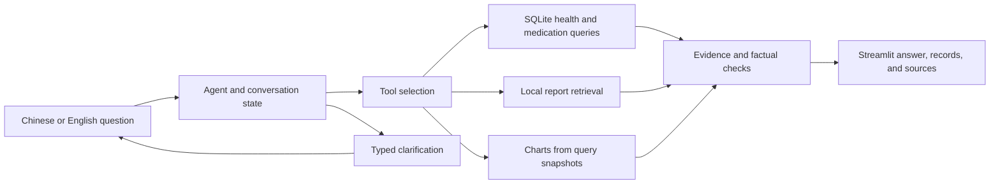

English | [简体中文](README.zh-CN.md)

# Personal Health Data Agent

A local-first agent for querying personal health records, retrieving report evidence, and visualizing original measurements. Built with Python, LangGraph, Streamlit, SQLite, Chroma, and Ollama.

**All bundled data is synthetic.** This is a course prototype for auditable data analysis, not a diagnostic or prescribing system.

## Features

- **Chinese and English:** switch the interface language; replies and clarifications follow the question language. Original quotations retain their source language.
- **Structured queries:** retrieve glucose, weight, and paired blood-pressure records with dates, units, measurement conditions, and record IDs.
- **Medication-event comparisons:** compare explicit before/after windows using program-calculated counts, means, and changes. Insufficient samples and overlapping events stop the comparison.
- **Local report RAG:** retrieve passages with file and line references; distinguish excerpt-based answers from controlled full-text term scans.
- **Original-data charts:** generate PNG, SVG, and JSON exports without inventing missing measurements.
- **Verifiable answers:** inspect tool traces and sources; unsupported values, units, and claims are rejected. Simple record results are explicitly labeled program receipts.

## Preview


## How it works



The model chooses tools; the application handles date constraints, SQL, statistics, chart data, and verification. A descriptive before/after difference does not establish a medication effect.

## Quick start

Validated on **macOS arm64 with Python 3.12**. Install Python 3.12 and the official [Ollama CLI](https://ollama.com/download). Model weights are downloaded separately.

For a fresh clone:

```bash
git clone https://github.com/JingyiChen1107/personal-health-data-agent.git
cd personal-health-data-agent
python3.12 -m venv .venv
.venv/bin/python -m pip install -r requirements.txt
cp .env.example .env
.venv/bin/python scripts/start_local.py

OLLAMA_HOST=127.0.0.1:11435 ollama pull qwen3.5:4b-q4_K_M
OLLAMA_HOST=127.0.0.1:11435 ollama pull embeddinggemma:300m
.venv/bin/python scripts/prepare_demo.py --initialize --reindex
```

Open **http://127.0.0.1:8501/**. Select **English** under **语言 / Language** in the sidebar. On an existing installation, keep your current `.env` and database.

The default LLM is `qwen3.5:4b-q4_K_M`; embeddings use `embeddinggemma:300m`. Both run through local Ollama on port **11435**, with no API key required. Installation and model downloads require network access. Other platforms have not completed the full acceptance suite.

## Example questions

- `What is my latest blood glucose?`
- `List my fasting glucose records from October 1 to October 15, 2026.`
- `Plot my weight from October 1 to October 23, 2026.`
- `Compare fasting glucose 14 days before and after the metformin change on October 1, 2026.`
- `What does report R003 say about organizing blood glucose records?`

The demo reference date is fixed at **2026-10-23**, **America/Chicago**. An unknown glucose measurement condition is not treated as non-fasting. Comparison windows include their start and exclude their end; the event day is excluded.

## Validation — v0.9.0

| Check | Chinese | English |
|---|---:|---:|
| Main scenarios | 19/20 | 18/20 |
| Five core scenarios, three runs each | 15/15 | 15/15 |
| Questions against an uploaded English report | 1/1 | 1/1 |

**275 offline tests passed**, including the same tests from a freshly extracted distribution using the verified dependency environment. The formal run contains 62 executions: two direct tool-boundary checks and 60 real local-agent tasks. These are system task-completion results, not bare-model accuracy or clinical validation.

Remaining failures: thyroid follow-up questions in both languages (T16), and the English report-plus-latest-glucose task (T20). Rejection or an unnecessary clarification counts as incomplete. Model prose can be less precise than the displayed start-inclusive/end-exclusive comparison card; term scans cover only the selected reports and listed aliases. More formats, multiple real patients, and production deployment are outside the validated scope.

See the [acceptance report (Chinese)](docs/M4_质量验证与交付.md) and [frozen results](evidence/final_acceptance/results.json). The published evidence is from the accepted run, not a combination of earlier trials.

## Project milestones

| Stage | Scope | Documentation |
|---|---|---|
| M1 | Data model, units, dates, and tools | [Data and tool foundation](docs/M1_数据与工具底座.md) |
| M2 | Agent orchestration, models, and conversation recovery | [Agent and model integration](docs/M2_Agent与模型集成.md) |
| M3 | Report retrieval, citations, and charts | [RAG and visualization](docs/M3_RAG与可视化.md) |
| M4 | Quality checks, measured results, and delivery | [Validation and delivery](docs/M4_质量验证与交付.md) |

The detailed milestone documents and [operations guide](deliverables/使用与交接.md) are in Chinese. This README and [简体中文](README.zh-CN.md) provide matching entry points.

## Tests and local evaluation

```bash
.venv/bin/python -m health_agent validate
.venv/bin/python -m unittest discover -q

# Requires the local models; always use a new output directory.
.venv/bin/python scripts/bilingual_acceptance.py --output artifacts/acceptance/new_run
```

Full acceptance also requires reading every displayed answer and running the source/chart audit described in the [bilingual acceptance protocol](docs/双语验收协议.md). The real-model suite is separate from offline unit tests.

## Repository layout

```text
health_agent/       Agent, tools, retrieval, plotting, and verification
streamlit_app.py    Bilingual local interface
config/            Frozen demo configuration
sample_data/       Synthetic records and report fixtures
scripts/           Startup, preparation, evaluation, and packaging
tests/             Offline tests and frozen scenarios
docs/              M1–M4 milestones, protocol, and preview images
deliverables/      Operations guide
evidence/          Accepted synthetic evaluation evidence
```

Local credentials, virtual environments, model weights, live databases, conversation history, incidental uploads, and historical Day archives are excluded from this repository.
