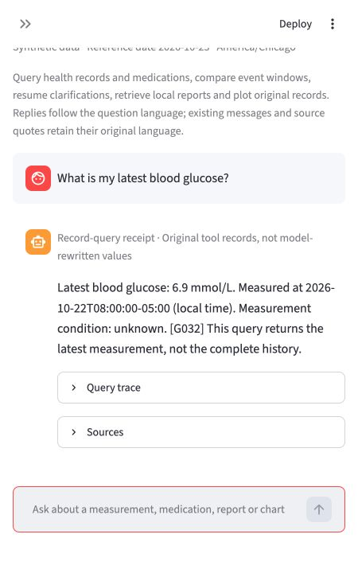
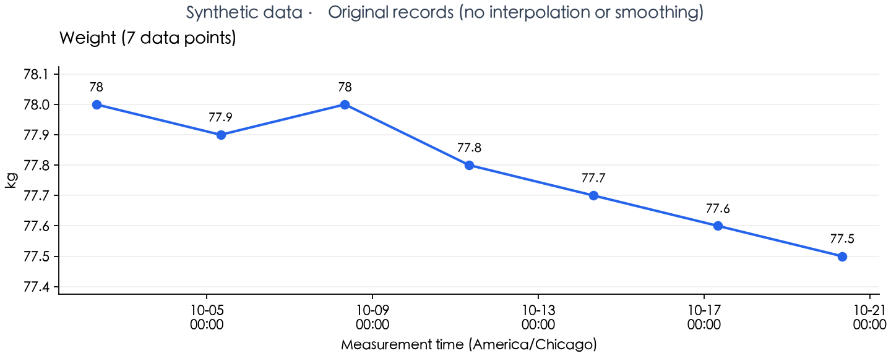

[English](README.md) | 简体中文

# 个人健康数据分析 Agent

在本机查询健康记录、检索报告依据，并展示原始测量图表。项目使用 Python、LangGraph、Streamlit、SQLite、Chroma 和 Ollama。

**随附数据全部虚构。** 本项目是可追溯数据分析的课程原型，不用于诊断或处方。

## 功能

- **中英双语**：侧栏切换界面语言；回答和追问跟随问题语言，原文引用保留源文语言。
- **结构化查询**：查询血糖、体重和成对血压，保留日期、单位、测量条件和记录 ID。
- **用药事件前后比较**：程序计算明确窗口内的样本数、均值和变化；样本不足或存在其他事件时停止比较。
- **本地报告 RAG**：给出原文片段及文件、行号定位；区分片段检索和受控全文术语扫描。
- **原始记录绘图**：导出 PNG、SVG 和 JSON，不补造缺失测量。
- **事实与来源校验**：保留工具轨迹，拒绝无依据数值、单位和断言；简单记录明确标为程序回执。

## 界面示例





## 工作方式

模型选择工具，应用处理日期约束、SQL、统计、图表数据和事实校验。会话可暂停并通过标准字段追问恢复。用药前后的描述性变化不代表药物因果效果。

## 快速开始

完整验证环境为 **macOS arm64、Python 3.12**。先安装 Python 3.12 和官方 [Ollama CLI](https://ollama.com/download)，模型权重需另行下载。

首次克隆：

```bash
git clone https://github.com/JingyiChen1107/personal-health-data-agent.git
cd personal-health-data-agent
python3.12 -m venv .venv
.venv/bin/python -m pip install -r requirements.txt
cp .env.example .env
.venv/bin/python scripts/start_local.py

OLLAMA_HOST=127.0.0.1:11435 ollama pull qwen3.5:4b-q4_K_M
OLLAMA_HOST=127.0.0.1:11435 ollama pull embeddinggemma:300m
.venv/bin/python scripts/prepare_demo.py --initialize --reindex
```

打开 **http://127.0.0.1:8501/**，侧栏“语言 / Language”可切换中文和 English。已有安装请保留原 `.env` 与数据库。

默认模型为 `qwen3.5:4b-q4_K_M`，embedding 为 `embeddinggemma:300m`，均通过本机 **11435** 端口的 Ollama 运行，无需 API 密钥。安装和下载需要联网；其他平台尚未完成整套验收。

## 示例问题

- 我最近一次血糖是多少？
- 2026年10月1日至15日的空腹血糖记录是什么？
- 画出2026年10月1日至23日的体重趋势。
- 比较2026年10月1日二甲双胍调整前后14天的空腹血糖。
- R003报告对血糖记录整理是怎么说的？

演示参考日固定为 **2026-10-23**，时区为 **America/Chicago**。条件未知不等于非空腹。比较窗口左闭右开，事件当天不计入任一窗口。

## v0.9.0 验收

| 检查 | 中文 | 英文 |
|---|---:|---:|
| 主场景 | 19/20 | 18/20 |
| 五类核心场景各运行三次 | 15/15 | 15/15 |
| 上传英文报告后提问 | 1/1 | 1/1 |

**275 项离线测试通过**，新解压分发包也在已验证依赖环境下通过同样测试。正式验收共62个执行，其中2个为直接工具边界检查、60个为真实本地Agent任务。成绩描述系统任务完成情况，不代表裸模型准确率或临床验证。

未完成项：两种语言的甲状腺复查安排问题（T16），以及英文“读报告后查最新血糖”混合任务（T20）。校验拒绝和多余追问不算完成。比较日期以界面“开始含、结束不含”为准；术语扫描只覆盖指定报告和列出的别名。更多格式、多个真实患者及生产部署不在已验证范围内。

完整说明见 [M4 验收报告](docs/M4_质量验证与交付.md)和[冻结原始结果](evidence/final_acceptance/results.json)。公开证据来自同一正式接受轮，不拼接历史试验。

## 按里程碑阅读

| 阶段 | 内容 | 文档 |
|---|---|---|
| M1 | 数据模型、单位、日期和工具 | [数据与工具底座](docs/M1_数据与工具底座.md) |
| M2 | Agent编排、模型和追问恢复 | [Agent与模型集成](docs/M2_Agent与模型集成.md) |
| M3 | 报告检索、引用和图表 | [RAG与可视化](docs/M3_RAG与可视化.md) |
| M4 | 质量校验、实际结果和交付 | [质量验证与交付](docs/M4_质量验证与交付.md) |

安装细节、演示和已知问题统一见[使用与交接](deliverables/使用与交接.md)。不再按 Day 划分当前文档。

## 测试与本地验收

```bash
.venv/bin/python -m health_agent validate
.venv/bin/python -m unittest discover -q

# 需要本地模型，输出必须使用新目录。
.venv/bin/python scripts/bilingual_acceptance.py --output artifacts/acceptance/new_run
```

完整验收还须按[双语验收协议](docs/双语验收协议.md)逐条阅读回答并复核来源、图表。真实模型验收与离线测试分开。

## 仓库结构

```text
health_agent/       Agent、工具、检索、绘图与校验
streamlit_app.py    双语本地界面
config/            冻结演示配置
sample_data/       虚构记录与报告样例
scripts/           启动、预检、验收与打包
tests/             离线测试与冻结场景
docs/              M1–M4、验收协议与预览图
deliverables/      使用与交接
evidence/          正式接受轮的虚构验收证据
```

本机密钥、虚拟环境、模型权重、运行数据库、会话历史、临时上传和旧 Day 历史归档不进入公开仓库。
