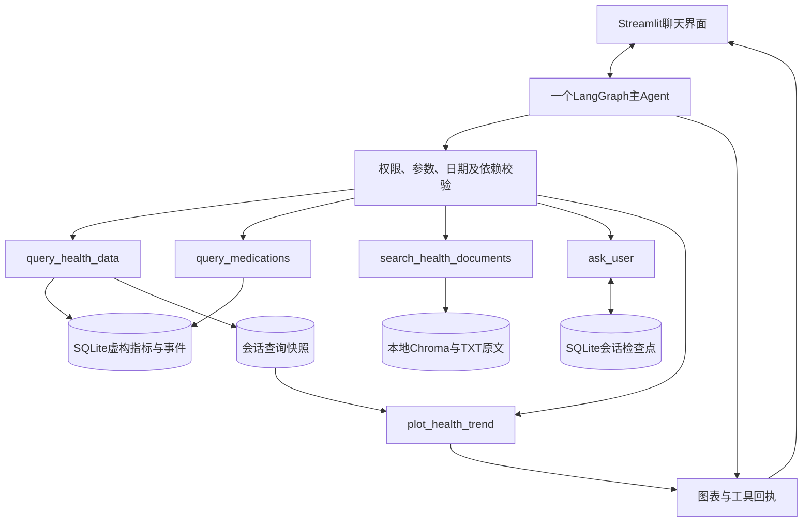

# M2｜Agent编排、模型与会话集成

v0.9.0已加入中文/英文界面、提问、回复、追问与业务回执；当前正式成绩以[M4](M4_质量验证与交付.md)为准。

里程碑目标：让一个主Agent在真实本机模型上选择工具、处理依赖并恢复追问任务。能力已实现；不把早期选型成绩替代[M4统一验收](M4_质量验证与交付.md)。

## 系统结构

模型选择任务、工具和依赖顺序；代码执行SQL、日期算术、统计及绘图。上传和建索引由界面应用完成，模型没有任意写文件或自由SQL权限。五个工具的事实边界分别见[M1](M1_数据与工具底座.md)和[M3](M3_RAG与可视化.md)。

## 当前运行配置

| 项目 | 固定配置 |
|---|---|
| 主模型 | qwen3.5:4b-q4_K_M |
| 本地模型服务 | Ollama，127.0.0.1:11435 |
| 文档embedding | embeddinggemma:300m |
| 界面 | Streamlit，127.0.0.1:8501 |
| 已验证环境 | Apple M3、16GB，macOS arm64，Python 3.12 |
| 单请求输出/超时 | 1024 tokens / 180秒 |
| 启动参数 | 8192上下文、单路推理、仅本机服务 |

当前配置无需OpenAI或Hugging Face密钥。本地模型和embedding不切换到云端。云端兼容适配器只有代码与自动检查，不计入真实在线验收。

## 会话与工具依赖

- 主入口为`health_agent/conversation.py`，基于同一模型/工具循环；ask_user使用LangGraph interrupt与恢复命令。
- SqliteSaver将检查点保存在`data/conversations.sqlite3`；患者、会话、参考日期与数据库路径共同绑定身份。任务ID由应用产生，模型不能用自造ID读取其他任务。
- 同一会话串行调用；模型或Python实例重建后仍能从检查点恢复。普通新任务可承接条件，个人事实须重新查；暂停任务保留已经取得的结果及来源。
- “帮我看看血压”这类任务类型不清的输入先澄清。用药比较先读取真实事件，用户明确事件及条件后才计算；切换非血糖指标时清空不适用的空腹条件。
- 取消任务清除当前任务与会话快照；新建会话使用新身份。刷新页面可能建立新会话，跨浏览器找回与长期记忆未做完整验收。
- 单任务工具尝试受8次上限约束；重试、参数纠正和事实重写有上限，不为通过率无限循环。

## 历史模型选型（不是最终系统成绩）

下表来自2026-10-23的项目实测。同规则严格十题或提前筛选；未测项不算失败，失败题的短耗时不能作为速度优势。不同轮次、完整十题和共同三题的耗时不可直接混比。

| 首轮候选 | 通过/已测 | 未测 | 共同核心三题中位数 |
|---|---:|---:|---|
| qwen3:1.7b | 1/10 | 0 | 未达门槛 |
| granite4:3b | 1/6 | 4 | 未达门槛 |
| qwen3.5:2b-q4_K_M | 0/1 | 9 | 未达门槛 |
| qwen3:4b-instruct | 6/10 | 0 | 22.84秒 |
| ministral-3:3b | 3/10 | 0 | 32.25秒 |
| qwen3.5:4b-q4_K_M | 7/10 | 0 | 16.99秒 |

非Qwen补测：granite4.1:3b为1/10、核心0/3；gemma4:e2b-it-q4_K_M为3/10、核心2/3；ministral-3:8b为2/3、核心2/3，其比较最终回答超出当轮预算。按当时规则均未达到替换门槛，因此保留当前4B配置。原始记录仍在`artifacts/model_selection/`，完整旧报告已归档。

这些成绩描述当时版本的模型与应用组合，不表示现版裸模型准确率。v0.8.0历史18/20与关键15/15包含当时的工具、会话、防护和回执；v0.9.0中英文各自成绩见[M4](M4_质量验证与交付.md)。

## 完成标准与入口

模型真实选择查询与工具依赖，模糊问题会暂停，补充后恢复同一任务，已由最终T01/T10/T18等场景及关键三轮验证。测试替身只出现在自动检查中。实现入口还包括`agent.py`、`ollama_provider.py`、`app_support.py`和`tool_specs.py`；实际使用见[使用与交接](../deliverables/使用与交接.md)。

## 双语语言约定

语言由应用识别并写入会话状态，短事件ID与选项继承任务语言。模型输出语言独立校验；受控中英文药名标签、LDL别名和原文引用可保留，不等于整段答复可忽略语言要求。latest返回一条只说明此次查询上限，不能断言历史只有一条。
