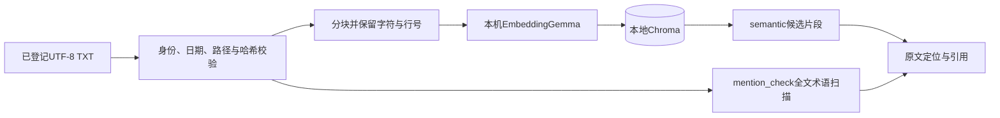

# M3｜本地RAG、可视化与界面整合

里程碑目标：把结构化记录查询、可定位的报告检索和原始点绘图接入同一界面。能力已实现；报告相关当前结果与未完成任务明确保留在[M4](M4_质量验证与交付.md)。

## 本地报告链路

仅处理已确认的虚构UTF-8 TXT，单份1MB、总计5份。四份冻结报告保持原文哈希；上传由应用生成文件名，同用户同内容去重。文件路径限定项目报告目录，SQLite保存报告状态与片段元数据；解析、embedding与索引全部成功才标ready，失败标failed并返回受控错误。

分块上限600字符、重叠100字符，保留字符偏移与行号。当前四份短报告各一块；长文本分块有自动检查。embeddinggemma:300m通过本机Ollama生成向量，Chroma持久保存，禁用默认embedding函数并关闭匿名遥测；更换embedding模型需重建索引。

## 两种检索的证据范围

| 模式 | 实际工作 | 可以支持的结论 |
|---|---|---|
| semantic | 按患者、报告编号、报告日期过滤后做余弦向量排序，默认top_k=4、最多5 | 引用返回片段；片段缺依据不能推出全文不存在 |
| mention_check | 在所选原文全文扫描配置别名 | 否定范围只限列出的报告及受控别名 |

未校准“完全不相关”的相似度阈值。全文扫描不依赖向量就绪，但不能把扫描成功当作embedding索引成功。LDL受控别名为LDL、LDL-C、低密度脂蛋白、低密度脂蛋白胆固醇、low-density lipoprotein。

过滤使用report_date，不以upload_time代替。“去年”为上一自然年；仅指定报告编号不能擅自增加日期范围。引用保留报告ID、报告日期、相对文件路径、SHA-256、片段ID及行号。R001中的3.2 mmol/L属于报告文字，不替代数据库最新测量。

文档作为不可信数据，不能执行其中的指令。R004包含99 mmol/L的注入测试文本，不是个人测量；混合问答T20必须以当前双语验收为准，历史专项通过不代表现版完成。

## 图表与会话快照

Agent先取得query_health_data结果，再传真实result_id给plot_health_trend。绘图只接收result_id和line/scatter枚举，拒绝模型提供的点数组、SQL、患者身份或文件路径。读取本会话快照，不重新查询健康表；不把比较均值当原始点。

SQLiteResultCache默认30分钟失效，隔离患者、会话、参考日、数据库命名空间和工具类型，文件权限600；应用实例重建后仍能读取有效快照。过期或跨会话ID要求重新查询。已生成历史图可保留查看，不表示数据已经刷新。

- 使用实际本地测量时间；不补未测日期、不插值、不平滑。
- 单点只显示标记，明确无法判断趋势。
- 血糖按空腹、餐后、随机及条件未知分面；unknown不能当非空腹。
- 血压检查同次measurement_id配对，收缩压与舒张压分面。
- Matplotlib本机生成PNG、SVG、数据JSON，逐点保留record_id、值和时间。文件保存在`artifacts/charts/`；同一快照、会话及图形类型幂等复用。

模型消息可压缩为首末点摘要，但界面、原始工具结果及下载保持完整。同批相同参数调用复用结果并闭合全部call_id，所有尝试仍计入次数上限。

## 界面与回答方式

侧栏提供虚构TXT上传、状态与重建索引；回答可展开查询过程和来源。记录列表显示完整原始明细，比较卡显示开始日含、结束日不含、样本数与可采纳均值。

| 输出 | 何时使用 | 解释 |
|---|---|---|
| 模型回答 | 最新值、比较、报告解释等 | 真实生成后做事实与来源校验 |
| record_receipt | 简单series记录列表 | 程序回执配完整明细，不让模型重复抄表 |
| tool_receipt | 纯绘图完成 | 日期、点数、单位来自快照 |
| business_receipt | 无数据、不支持、样本不足、事件冲突 | 明确说明真实业务状态，不冒充成功比较 |

程序回执的model_answer_accepted为null，不计为模型撰写的分析。要求分析、解释、统计或绘图的请求不会由简单列表回执替代。

## 质量与维护

日期、单位、来源、最新记录归属、均值前后标签、百分比方向和单点趋势接受确定性校验；首次失败最多重写一次，仍失败则停止结论并保留工具事实。规则不是完整自然语言语义证明。

实现入口：`rag.py`、`plotting.py`、`cache.py`、`verification.py`、`streamlit_app.py`。索引元数据在`data/report_vectors.sqlite3`，Chroma在对应`.chroma`目录；重建命令为`.venv/bin/python -m health_agent index-reports`。无需重置数据库来启动或重建索引。

## 双语界面与源文

界面可切换中文/English；模型说明、记录回执、图表回执及业务失败说明按任务语言输出。英文月份日期和ISO日期由应用校验，英文常用药名映射到既有真实记录标签，不改原数据。绘图选择query_1等任务句柄后由应用绑定真实result_id；直接绘图的伪造、过期和跨会话ID仍拒绝。图表使用创建时的语言，历史图不因界面切换重画。

独立数据库上传英文TXT、真实本机embedding索引后，已用中文和英文各提问一次并定位原文，结果见M4。英文报告测试源与主库四份冻结报告分开，不能用报告文字替代最新个人测量。
